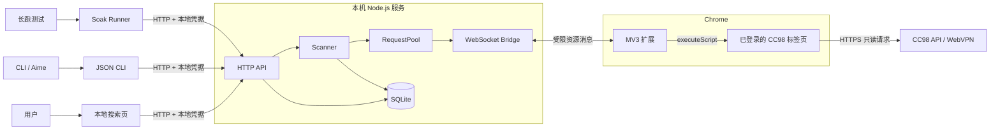
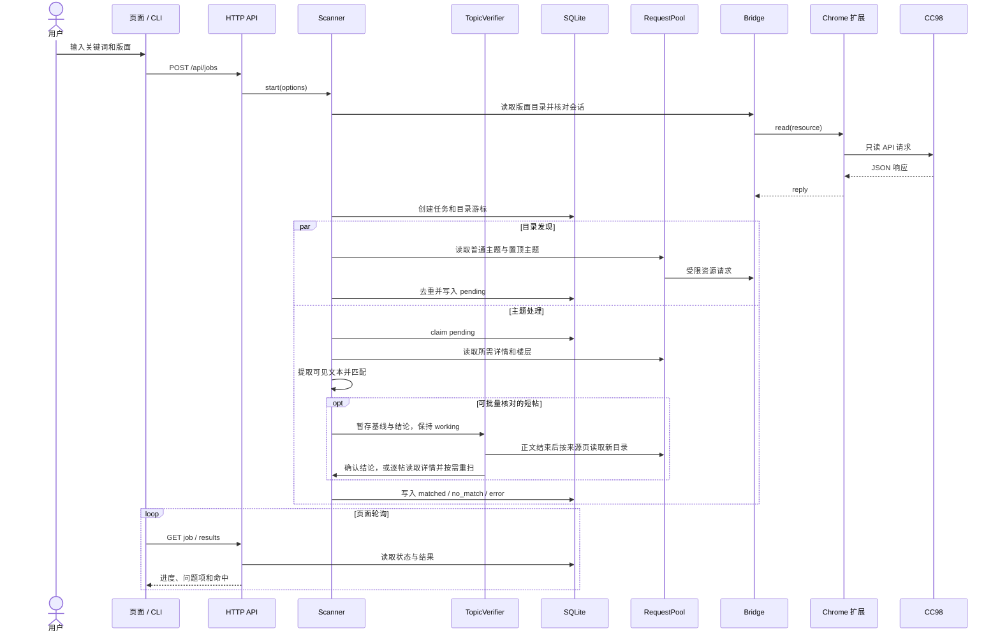
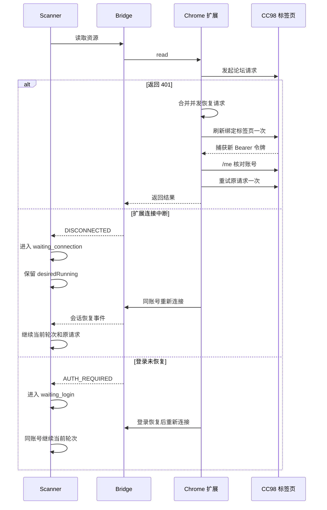
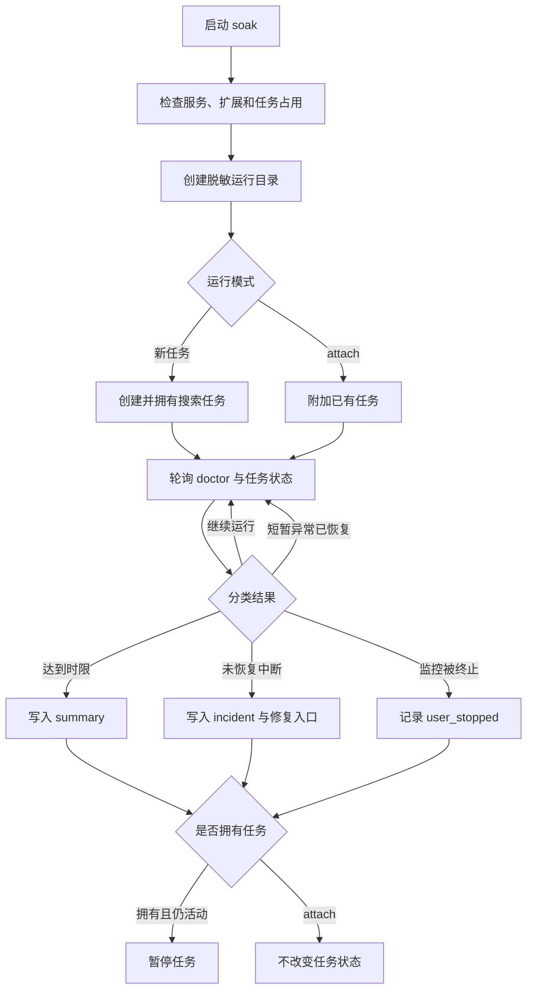

# CC98 帖子搜索架构

[返回用户说明](../README.md) · [开发者文档](DEVELOPMENT.md) · [Aime 调用说明](aime.md)

## 设计目标

系统需要在不收集账号密码、不把论坛令牌交给本地服务的前提下，扫描指定版面的主题标题和全部可读回复。长时间任务必须保存进度，并能处理令牌续期、扩展断线和服务重启。

核心设计选择：

- Chrome 扩展复用用户已经登录的 CC98 标签页。
- 本地 Node.js 服务负责扫描、匹配、状态管理和结果查询。
- SQLite 持久化任务、轮次、目录游标和主题结论。
- 所有论坛请求经过统一请求池，限制并发和请求频率。
- 搜索结果明确区分“处理完成”和“目录完整性已验证”。

## 总体架构



系统分为三个运行边界：

| 边界 | 主要职责 | 不负责 |
| --- | --- | --- |
| 本地页面、CLI、Soak Runner | 接收操作、查询状态、展示或导出结果 | 不直接访问论坛 |
| Node.js 服务 | 调度扫描、控制请求、匹配正文、持久化任务 | 不持有论坛访问令牌 |
| Chrome 扩展与 CC98 标签页 | 复用登录态、执行白名单只读请求、处理令牌续期 | 不保存扫描结果 |

## 文件树与职责

```text
.
|-- README.md                    # 面向用户的安装和使用说明
|-- package.json                 # 项目信息、依赖和 npm 命令
|-- package-lock.json            # 锁定 Node.js 依赖版本
|-- tsconfig.json                # TypeScript 编译与类型检查配置
|-- .gitignore                   # 排除本地数据、依赖和内部文档
|-- start-cc98-search.sh         # macOS 和 Linux 启动入口
|-- start-cc98-search.cmd        # Windows 启动入口
|
|-- docs/
|   |-- ARCHITECTURE.md          # 系统结构、运行流程和设计边界
|   |-- DEVELOPMENT.md           # 开发环境、命令、API 和验证方法
|   `-- aime.md                  # Aime 与其他本机 Agent 的调用说明
|
|-- scripts/
|   `-- launch.mjs               # 安装依赖、启动或复用服务并打开页面
|
|-- src/
|   |-- cli.ts                   # JSON CLI 与前台服务入口
|   |-- server.ts                # HTTP API、静态资源、鉴权和组件装配
|   |-- scanner.ts               # 目录发现、主题扫描和任务恢复
|   |-- topic-verifier.ts        # 短帖批量目录核对和逐帖回退
|   |-- pool.ts                  # 并发限制、请求频率、重试和退避
|   |-- site.ts                  # CC98 资源读取语义与响应校验
|   |-- matcher.ts               # UBB、Markdown 和纯文本匹配
|   |-- query.ts                 # 分组条件校验、规范化和可读表达式
|   |-- dictionary.ts            # 公司、地点与技能词典及分组建议
|   |-- store.ts                 # SQLite 任务、轮次、游标和结果
|   |-- bridge.ts                # 扩展 WebSocket、心跳和连接诊断
|   |-- types.ts                 # 跨模块数据类型与输入校验
|   |-- soak.ts                  # 长跑参数、采样、分类和诊断产物
|   `-- soak-cli.ts              # Soak Runner 命令行入口
|
|-- extension/
|   |-- manifest.json            # Chrome MV3 权限、入口和版本
|   |-- background.js            # 自动连接、账号确认和令牌恢复
|   |-- protocol.js              # 白名单资源到论坛 API 的转换
|   |-- local.js                 # 本地页面识别与 bootstrap 校验
|   |-- popup.html               # 扩展弹窗结构
|   `-- popup.js                 # 扩展状态展示和用户操作
|
|-- web/
|   |-- index.html               # 本地搜索页面结构
|   |-- style.css                # 页面样式与响应式布局
|   |-- query-editor.js          # 分面、别名、布尔关系编辑与条件预览
|   `-- app.js                   # 搜索交互、状态轮询和结果导出
|
`-- test/
    |-- fixture.ts               # 固定论坛数据与模拟传输
    |-- scanner.test.ts          # 扫描、分页、恢复和限频测试
    |-- query.test.ts            # 条件校验、词典建议和布尔真值表
    |-- faceted.test.ts          # 多词证据、HTTP/CLI 和带延迟的扫描对照
    |-- short-topic.test.ts      # 短帖详情核对、变化回退和边界测试
    |-- batch-topic.test.ts      # 批量请求数、核对时序和中断恢复测试
    |-- extension.test.ts        # 页面协议与登录状态测试
    |-- auto-connect.test.ts     # 扩展自动绑定和令牌恢复测试
    |-- integration.test.ts      # WebSocket、HTTP、CLI 和持久化集成测试
    |-- launcher.test.ts         # 后台启动和跨平台命令测试
    `-- soak.test.ts             # 长跑参数、分类和生命周期测试
```

以下目录只在本机运行或开发时产生，不属于公开源码：

| 路径 | 内容 |
| --- | --- |
| `.cc98/` | SQLite、服务发现文件、日志和 soak 诊断产物 |
| `.internal/` | 设计草稿、实现计划、推进记录和调查材料 |
| `node_modules/` | 安装后的依赖 |
| `test-artifacts/` | 自动化测试临时文件 |

依赖方向保持单向：`Scanner` 只依赖 `Transport` 接口和 `Store`，不了解 Chrome、WebSocket 或 SQLite 的具体实现。测试可以用 Fixture 替换真实浏览器传输。

## 启动与连接

启动脚本会启动或复用本地服务，再打开搜索页。扩展从本地页面的隔离世界读取连接信息，检查 CC98 标签页、登录态和 API 地址，通过 `/me` 确认账号，最后向 Bridge 发送 `hello` 建立连接。

首次绑定需要本地搜索页。绑定信息保存后，扩展可以直接重连本地服务。论坛访问令牌只存在于浏览器会话和页面执行上下文，本地服务只接收账号 ID、论坛站点和请求结果。

## 搜索主链路



目录发现和主题处理共享同一个请求池。目录可以继续加入候选主题，工作协程同时消费 `pending` 队列。满足完整搜索条件后停止读取后续楼层；使用目录基线的短帖还需经过批量或详情核对再保存。未满足条件时读取到预期楼层范围或实际空页，并复查元数据。

查询支持组间和组内两层 AND/OR，逻辑词内部的别名按 OR 匹配。词典生成可编辑的建议，未知词原样保留。每轮扫描只编译一次查询，各主题独立累计证据，每段可见文本只解析一次。交集按整帖判断，多条件正文命中在提交前核对基线，变化重扫时清空旧证据。建议接口只查本地词典，不调用论坛或大模型。

## 目录与匹配

目录扫描按版面执行两遍，并合并置顶主题：

1. 读取版面详情，取得当前主题数上界。
2. 按偏移读取目录，相邻页保留两个主题的重叠。
3. 遇到非空短页时读取下一偏移，确认真实尾部。
4. 按主题 ID 去重并持续写入 SQLite。
5. 第二遍重新检查目录，降低扫描期间内容移动造成的遗漏。

主题处理通常先读取详情，以实际 `boardId` 判断是否仍在搜索范围。标题未命中时，再分页读取主楼和回复。UBB 与 Markdown 会转换为可见文本；媒体地址、附件内容和已删除楼层不参与匹配。

目录字段齐全且有效、版面在范围内、标题未命中且最多 10 楼的短帖，可以省去首次详情请求。普通目录发现时记录来源版面、偏移和页大小，正文读完后交给 `TopicVerifier` 按来源页分组。一次新目录请求可核对同组多个主题；只有标题、版面、回复数和最后回复时间均与基线一致时，才保存结论。候选消失、字段变化或目录响应异常时，逐帖读取详情，必要时重扫正文。单条分组、置顶和缺少来源的旧记录沿用详情核对。

待核对集合达到 40 条时暂停领取并启动核对，允许已经在读正文的协程收尾。有空位后立即恢复领取，同组的详情回退并发执行，所有实际请求仍受共享请求池限制。即使并发为 1，也能在正文读完后继续领取主题、积累一批。每次核对只处理请求发起前已读完正文的候选，不复用发现阶段的目录响应；期间新完成的正文进入下一批。目录与正文扫描结束后排空剩余批次，主动停止也会等待后台核对退出。

固定数据回归中，同页 20 个稳定短帖使用 20 次正文请求和 1 次目录核对，原有两次目录发现另计。分页、异常回退会增加请求，真实论坛吞吐收益仍待验证。

CC98 目录使用偏移分页，没有稳定快照。即使两遍扫描都结束，也不能证明扫描期间没有主题移动，因此正常结束状态是 `finished_unverified`。

## 自恢复链路



自动恢复必须满足账号和论坛站点一致。切换账号、手动暂停或取消会清除 `desiredRunning`，后续连接不会自动覆盖用户决定。

服务重启时，SQLite 会把遗留的活动任务标记为 `paused`，但保留运行意图。原账号扩展重新连接后，Scanner 将遗留的 `working` 主题放回 `pending`，继续原轮次，不重扫已完成主题。

## 任务状态

任务从 `running` 进入 `waiting_connection` 或 `waiting_login` 后，同账号恢复会回到当前轮次。手动暂停、取消或账号变化会结束自动续跑意图。用户从 `paused` 或 `cancelled` 手动恢复时会创建新轮次，旧轮次继续保留。正常结束使用 `finished_unverified`，仍有读取问题时使用 `partial`。

## Soak 长跑



Soak Runner 只通过本地 HTTP API 工作，不直接访问 SQLite 或 CC98。它采集任务进度和脱敏连接状态，记录到 `.cc98/soak/`。

默认模式由 soak 创建任务，因此达到时限、发生未恢复中断或收到终止信号时，会暂停自己创建且仍在运行的任务。`--attach JOB_ID` 只观察已有任务，退出时不暂停该任务。

## 持久化模型

SQLite 使用三个核心表：

| 表 | 内容 | 作用 |
| --- | --- | --- |
| `jobs` | 每个任务的最新状态 | 页面和 CLI 查询当前状态 |
| `runs` | 每轮任务的状态快照 | 保留恢复历史 |
| `topics` | 每轮主题状态、结果和错误 | 去重、断点恢复和导出 |

`topics` 以任务 ID、轮次和主题 ID 作为联合主键。正文不会完整落盘，只保存主题元数据、处理状态、错误和命中片段。新查询的条件与别名快照放在 `options.query`，结果的各词证据放在 `evidence`，都复用 JSON 字段。旧单关键词数据形状不变。

任务创建后条件固定，恢复直接使用快照，不重新展开词典。提前停止读取的结果仅用于当前条件，不能用来推算扫描后的任意新条件；修改词或关系需新建任务。

来源页存入主题 JSON，无需新增表或列。批量核对前的主题保持 `working`，基线和暂存命中留在有界内存集合中。正常停止时未确认项退回 `pending`；进程崩溃则由既有恢复流程处理遗留 `working`，重读正文后再确认。

目录游标记录复查轮次、版面序号和下一偏移。暂停或进程退出后，已经完成的 `matched`、`no_match` 和 `out_of_scope` 不需要重新扫描。

## 安全边界

- 本地服务只监听 `127.0.0.1`。
- HTTP API 要求本地 Bearer 凭据，并校验 Host、Origin 和 Fetch Metadata。
- WebSocket 只接受 Chrome 扩展来源、固定路径和有效配对信息。
- 扩展只接受预定义资源类型，不能代理任意 URL。
- 论坛令牌保留在 Chrome 会话中，不写入 SQLite、服务日志或 soak 诊断包。
- 论坛请求均为读取操作，不包含发帖、编辑或删除接口。
- 论坛响应使用结构化解析，页面输出使用 `textContent`，结果链接只接受 HTTPS。

## 关键限制

- 电脑休眠、关机或 Chrome 退出时，论坛读取无法继续。
- WebVPN 登录和 CC98 登录相互独立，任一层失效都可能阻断请求。
- 权限受限、隐藏或历史异常楼层可能返回空内容，只能记录为读取问题。
- 偏移分页无法提供一致性快照，`finished_unverified` 不能解释为绝对完整。
- 基线核对无法识别不改变标题、版面、回复数和最后回复时间的旧楼层编辑。
- 自动化测试使用固定数据，真实权限、吞吐量和分页行为仍需长跑验证。
